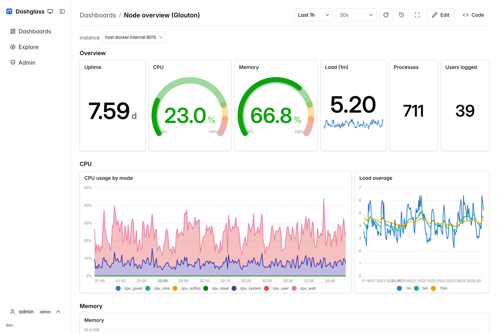

# Dashglass

Lightweight, Prometheus-native dashboards with first-class GitOps support:
dashboards are edited in the UI and stored as JSON/YAML/TOML files you can
version, review and deploy through git.



- **Just the dashboards** — the dashboard part of Grafana, nothing else:
  one small Go binary, no database, no bundled kitchen sink.
- **Files are the product** — every dashboard is a git-friendly file with
  deterministic serialization: a one-field edit produces a one-line diff.
  Edit in the UI, review in git, or run fully provisioned (`-readonly`).
- **Git-native history** — browse a dashboard's versions, diff them and
  restore one, straight from the UI (backed by `git log`). Optional
  commit-on-save and push/pull sync with a remote close the GitOps loop:
  edit in the browser, land an attributed commit, and pull teammates'
  changes live.
- **Prometheus-native** — queries go through a read-only proxy to your
  Prometheus; a built-in PromQL editor with live autocompletion, an
  Explore view, chained dashboard variables.
- **Interactive, not just static** — repeat a panel across the values of a
  variable (one definition, one tile per instance), and drill down from any
  panel to another dashboard or an external tool with the current variables
  and time range carried in the link.
- **Grafana import** — convert dashboards from a JSON export or straight
  from grafana.com, with honest per-panel warnings.
- **Batteries where it counts** — local users with three roles, plus
  reverse-proxy and OIDC authentication; the Prometheus data source and git
  remote are configurable at runtime from the admin UI; light & dark themes;
  keyboard shortcuts and a kiosk mode for wall screens.

## Quickstart

With Docker Compose (includes a demo Prometheus scraping itself, so the
sample dashboards have data out of the box):

```sh
git clone https://github.com/bleemeo/dashglass && cd dashglass
docker compose up
# open http://localhost:8080
```

Starting from an empty instance? The home screen offers ready-made
example dashboards (built only from metrics Prometheus exposes about
itself, so they show real data immediately) — create one in a click, or
import from Grafana.

Or as a single binary against your own Prometheus:

```sh
pnpm install && pnpm build-binary
./dashglass -prometheus-url http://localhost:9090 -dashboards-dir ./dashboards
```

### First run and authentication

A fresh instance starts with authentication **disabled: anyone who can
reach it has full (admin) access**. To enable authentication, create the
first admin user from **Admin → Create the first user** — everyone is
then asked to sign in. Alternatives for automated deploys:

- `DASHGLASS_BOOTSTRAP_ADMIN_PASSWORD=…` creates an `admin` user at startup;
- `./dashglass user add <name> [role]` is the break-glass CLI.

Local users get one of three roles (viewer / editor / admin). Reverse-proxy
header authentication and native OIDC (authorization code + PKCE, with
groups → role mapping) are configured through `dashglass.yaml` — see
[dashglass.example.yaml](./dashglass.example.yaml) for the annotated reference.

## Repository layout

- `packages/model` — dashboard data model: Zod schemas (Perses-derived),
  deterministic JSON/YAML/TOML serializers, schema migrations.
- `packages/runtime` — plugin registries, query orchestrator and dashboard
  rendering engine.
- `packages/panels-builtin` — built-in panel plugins: time series, stat,
  gauge, table, bar, heatmap, status grid, markdown (ECharts).
- `packages/datasource-prometheus` — Prometheus data source over the
  native HTTP API paths.
- `packages/promql-editor` — CodeMirror PromQL editor with live
  autocompletion.
- `packages/grafana-import` — best-effort Grafana JSON → Dashglass converter.
- `packages/ui` — Chakra theme, color mode and shared styling.
- `apps/dashglass` — the open-source app shell (dashboard list, viewer,
  form-based and as-code editors, Explore, admin).
- `backend/` — Go server: SPA hosting, Prometheus proxy, dashboard file
  management (CRUD + validation + fsnotify/SSE live reload), auth.

See the [user guide](./docs/user-guide.md) for how to build and operate
dashboards, and [DESIGN.md](./DESIGN.md) for the full design document (its
[§13 feature status](./DESIGN.md#13-feature-status) is the canonical list of
what exists).

## Development

```sh
pnpm install
pnpm test
pnpm typecheck
```

Backend:

```sh
cd backend
go test ./...
go run . -prometheus-url http://localhost:9090 -dashboards-dir ../dashboards
```

App development (vite dev server on :3000, proxying /api to the backend
on :8080):

```sh
pnpm --filter dashglass dev
```

Full single-binary build (SPA embedded):

```sh
pnpm build-binary
./dashglass -prometheus-url http://localhost:9090 -dashboards-dir ./dashboards
```

The dashboard JSON Schema used by the backend is generated from the Zod
schemas (`pnpm generate-schema` in `packages/model`); regenerate it after
changing the model. `./dashglass lint [paths...]` validates dashboard files
(used in CI).

## License

Dashglass is licensed under the [Apache License 2.0](LICENSE).
